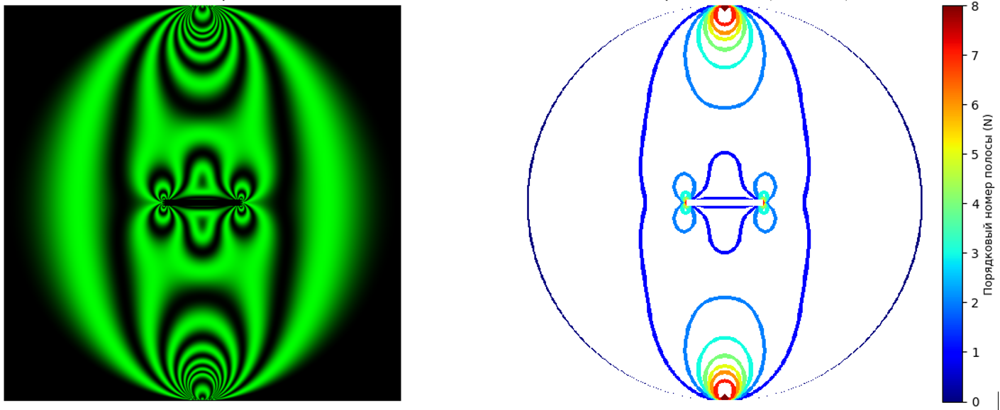

# Лабораторная работа №1
 **ФИО:** Шестерина Софья Сергеевна

 **Группа:** 6405-010302D
 
 **Научный руководитель:** Степанова Лариса Валентиновна
 
 **Предполагаемая тема диплома:** Сверточные нейронные сети для реконструкции изображений, получаемых экспериментальными методами механики
 
> «Нож – самое прочное, самое бессмертное, самое гениальное из всего, созданного человеком. Нож – был гильотиной, нож – универсальный способ разрешить все узлы, и по острию ножа идет путь парадоксов – единственно достойный бесстрашного ума путь…»
>
> 
<i>— Д-503, Е.И. Замятин "Мы"</i>

# Лабораторная работа №2

Web-сайт: интеллектуальный клуб Самарского университета

### Описание

1. **Структура сайта**: Создано **4 страницы**:
   * Главная (`index.html`) — описание клуба.
   * Расписание (`schedule.html`) — формат, время и места проведения встреч.
   * Рейтинг (`rating.html`) — турнирная таблица текущего сезона.
   * Правила (`rules.html`) — памятка со ссылками на регламенты.

2. **HTML**:
   * Использованы блочные (`header`, `main`, `div`, `p`) и строчные (`strong`, `span`, `del`) элементы.
   * Добавлены ссылки (внешние ссылки на правила игр).
   * Изображения (логотип вуза, фото с игры).
   * Реализована таблица на странице рейтинга.

3. **CSS**:
   * Отдельный подключаемый файл `style.css`.
   * Применено более 3 видов селекторов (по тегам, классам, селекторы потомков и псевдоклассы `:hover`).
   * Выполнено разное выравнивание в таблице: по левому краю (названия), по центру (туры), по правому краю (очки).

# Лабораторная работа №3
Была создана отдельная ветка lab3 в репозиторий для лабораторных работ и создана папка lab3. В нее был загружен каркас проекта.
Проект реализован в соответствии с заданием, были написаны функции:
1. isInteger — проверяет, является ли переданное число целым, используя побитовую операцию или (| 0).
2. even — формирует и возвращает массив всех чётных чисел от 2 до 20 включительно.
3. sumTo — вычисляет сумму всех натуральных чисел до заданного числа n с помощью обычного цикла for.
4. recSumTo — выполняет аналогичный расчёт суммы чисел до n, но использует для этого рекурсивный подход.
5. factorial — находит факториал переданного числа n через классическую рекурсию.
6. isBinary — определяет, представляет ли собой число степень двойки, последовательно деля его на 2 во встроенном цикле.
7. fibonacci — возвращает n-е число из последовательности Фибоначчи рекурсивным методом.
8. getOperationFn — возвращает замыкание, которое сохраняет промежуточное состояние и последовательно применяет к нему переданную функцию-оператор.
9. sequence — создаёт независимые функции-генераторы для получения элементов арифметической прогрессии с настраиваемым стартом и шагом.
10. deepEqual — выполняет глубокое рекурсивное сравнение двух сущностей (как примитивов, так и вложенных объектов/массивов) по их структуре и наполнению.

